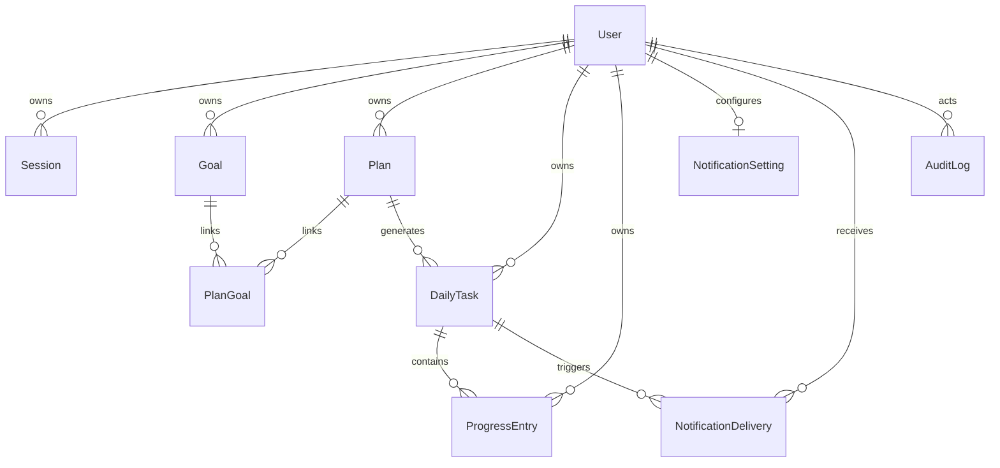

# TodoAll 核心数据模型

本文描述逻辑模型。第一版使用 SQLite，最终字段类型和约束在技术脚手架确定后落入数据库迁移。

## 1. 关系概览

所有业务表都直接保存 `user_id`，便于统一实施数据隔离；不能仅依赖多层关联推导用户归属。

## 2. 实体定义

### 2.1 User

| 字段 | 说明 |
| --- | --- |
| id | 用户主键 |
| login_name | 唯一登录账号 |
| display_name | 展示名称 |
| password_hash | 密码哈希 |
| role | `admin` 或 `user` |
| status | `active` 或 `disabled` |
| must_change_password | 是否强制修改密码 |
| timezone | 用户时区，默认 `Asia/Shanghai` |
| last_login_at | 最后登录时间 |
| created_at / updated_at | 创建和更新时间 |

### 2.2 Session

保存登录会话、过期时间、撤销时间和必要的设备摘要。密码修改、管理员重置密码或账号禁用时撤销相关会话。

### 2.3 Goal

| 字段 | 说明 |
| --- | --- |
| id / user_id | 主键和所属用户 |
| name / description | 名称和说明 |
| start_date / due_date | 开始和截止日期 |
| metric_type | 可选计量维度 |
| target_value | 可选目标值 |
| unit | 可选单位 |
| status | 进行中、完成、暂停或放弃 |
| completed_at | 完成时间 |

描述型目标的 `target_value` 和 `unit` 可以为空。

### 2.4 Plan

| 字段 | 说明 |
| --- | --- |
| id / user_id | 主键和所属用户 |
| name / description | 名称和说明 |
| metric_type | 勾选、次数、时长、距离或数量 |
| target_value | 每次任务的目标值 |
| unit | 展示单位 |
| recurrence_type | 单次、每天、每周或连续若干天 |
| start_date / end_date | 生效日期范围 |
| weekdays | 每周计划的星期集合 |
| duration_days | 连续计划的天数 |
| execution_time | 可选的本地执行时间 |
| reminder_offset_minutes | 可选提前提醒分钟数 |
| status | 草稿、执行中、暂停或结束 |

`weekdays` 在数据库中应使用明确、可校验的表示方式，避免依赖语言环境中的星期名称。

### 2.5 PlanGoal

计划与目标的多对多关联表，包含 `plan_id`、`goal_id` 和 `user_id`。建立关联时必须校验两端属于同一用户。

### 2.6 DailyTask

| 字段 | 说明 |
| --- | --- |
| id / user_id / plan_id | 主键及归属 |
| task_date | 用户时区下的任务日期 |
| name_snapshot | 生成时的任务名称 |
| metric_type_snapshot | 生成时的计量维度 |
| target_value_snapshot | 生成时的目标值 |
| unit_snapshot | 生成时的单位 |
| execution_at | 计算后的 UTC 执行时间 |
| current_value | 当前累计值缓存 |
| status | 任务状态 |
| completed_at / skipped_at | 完成或跳过时间 |

`plan_id + task_date` 在第一版保持唯一，表示同一计划每天最多生成一个任务。

### 2.7 ProgressEntry

| 字段 | 说明 |
| --- | --- |
| id / user_id / daily_task_id | 主键及归属 |
| value | 本次完成量 |
| recorded_at | 实际记录时间 |
| note | 可选备注 |
| source | 手工、快捷增加或计时器 |

时长建议使用整数秒保存，距离使用整数米保存；展示时再换算成分钟、小时或公里，以减少浮点误差。

### 2.8 NotificationSetting

| 字段 | 说明 |
| --- | --- |
| user_id | 与用户一对一 |
| bark_enabled | 是否启用 Bark |
| bark_endpoint_encrypted | 加密保存的 Bark 地址 |
| daily_summary_enabled | 是否启用未完成汇总 |
| daily_summary_time | 用户本地汇总时间，默认 22:00 |
| timed_reminder_enabled | 是否启用时间点提醒 |
| default_offset_minutes | 默认提前量，默认 1 |

### 2.9 NotificationDelivery

| 字段 | 说明 |
| --- | --- |
| id / user_id | 主键和所属用户 |
| daily_task_id | 可选关联任务 |
| type | 每日汇总、时间点提醒或测试通知 |
| scheduled_at | 计划发送时间 |
| sent_at | 实际发送时间 |
| status | 待发送、发送中、成功、失败或取消 |
| attempt_count | 已尝试次数 |
| last_error | 脱敏后的最后错误 |
| deduplication_key | 唯一去重键 |

### 2.10 AuditLog

记录创建账号、禁用账号、重置密码、角色修改等管理操作。审计内容不保存密码、完整 Bark 地址、会话令牌等敏感数据。

## 3. 关键一致性规则

1. 每次读取或修改业务数据都同时校验资源 ID 和当前 `user_id`。
2. `DailyTask.current_value` 是执行记录之和的缓存，更新记录时必须在事务内重新计算。
3. 达到目标值时自动更新任务状态，删除执行记录后允许状态回退。
4. 历史每日任务保存计划快照，计划修改不得覆盖历史快照。
5. 通知去重依赖数据库唯一约束，不只依赖进程内状态。
6. 日期按用户时区解释，时间戳统一以 UTC 保存。
7. 金额式浮点类型不适合直接保存距离和时长；优先保存统一的最小整数单位。

## 4. SQLite 运行约束

- 启用 WAL 模式，并为并发写入配置合理的等待时间。
- Web 服务和后台 Worker 必须访问同一台机器上的同一个数据库文件。
- 数据库文件和备份目录必须放在持久化存储中，不能只存在于容器临时层。
- 部署迁移前先备份数据库文件，并定期执行自动备份和恢复验证。
- 第一版只运行一个应用实例；如果未来需要多机部署或大量并发，再迁移到 PostgreSQL。
